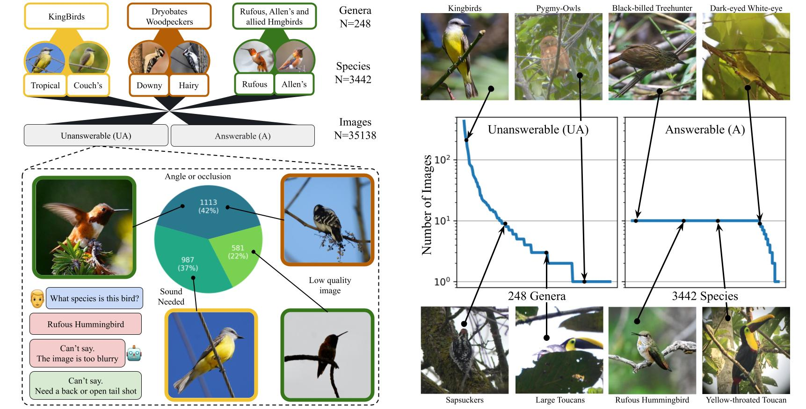

[🎉 RealBirdID is finally available!](https://huggingface.co/datasets/cvl-umass/RealBirdID)

# RealBirdID <a href="https://arxiv.org/abs/2603.27033">[arXiv]</a> <a href="https://huggingface.co/datasets/cvl-umass/RealBirdID">[HuggingFace]</a>

This is the supporting code for the visual abstention benchmark, RealBirdID (hosted in <a href="https://huggingface.co/datasets/cvl-umass/RealBirdID">[HuggingFace]</a>). It was proposed in:

### RealBirdID: Benchmarking Bird Species Identification in the Era of MLLMs

[Logan Lawrence](https://www.loganlawrence.info/), [Mustafa Chasmai](https://mustafa1728.github.io/), [Rangel Daroya](https://rangeldaroya.github.io/), [Wuao Liu](https://wuao652.github.io/), [Seoyun Jeong](https://www.linkedin.com/in/seoyun-yuni-jeong/), [Aaron Sun](https://aaronsun1030.github.io/), [Max Hamilton](https://johnmaxh.github.io/), [Fabien Delattre](https://fabiendelattre.com/), [Oindrila Saha](http://oindrilasaha.github.io), [Subhransu Maji](http://people.cs.umass.edu/~smaji/), [Grant Van Horn](https://gvh.codes)

[Computer Vision Lab @ UMass](https://www.cics.umass.edu/organizations/computer-vision-research-lab)

CVPR'26



## Getting Started

We highly recommend running [quickstart_ipynbs/view_random_example.ipynb](https://github.com/cvl-umass/RealBirdID/blob/main/quickstart_ipynbs/view_random_example.ipynb) to confirm you can load the data and get a sense of what it looks like. If you can run this, you're basically good to go!

## Citation
If you find this work useful, please consider citing:

```
@inproceedings{lawrence2026realbirdid,
  title={RealBirdID: Benchmarking Bird Species Identification in the Era of MLLMs},
  author={Lawrence, Logan and Chasmai, Mustafa and Daroya, Rangel and Liu, Wuao and Jeong, Seoyun and Sun, Aaron and Hamilton, Max and Delattre, Fabien and Saha, Oindrila and Maji, Subhransu and others},
  booktitle={Proceedings of the IEEE/CVF Conference on Computer Vision and Pattern Recognition},
  year={2026}
}
```

## Starter notebooks

Install `datasets`, `pillow`, `ipython`, and `jupyterlab` to run the notebooks.

- [Load data](quickstart_ipynbs/load_data.ipynb): inspect the schema and per-row licenses.
- [Browse examples](quickstart_ipynbs/view_random_example.ipynb): view images with attribution.
- [Baseline evaluation](quickstart_ipynbs/baseline_eval.ipynb): compare uniform species guessing with always abstaining.

RealBirdID is an evaluation benchmark. It has answerable and unanswerable validation sets, with no training split. The release includes 35,138 rows. Of these, 457 unanswerable rows have no recorded CC photo license and are labeled `all-rights-reserved` or `unknown`; inclusion does not grant reuse or redistribution rights. Those rows are stored in separate restricted shards and can be filtered by the per-row `license` column. The original null code is preserved in `source_license_code`.

Each row carries its photo license, attribution, and source links. Check these fields before reuse. Noncommercial, attribution, share-alike, and no-derivatives conditions apply where specified. See the dataset card for the release counts and license details.
